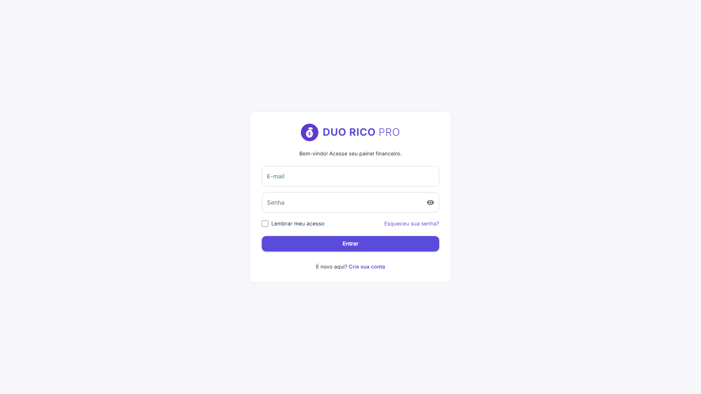
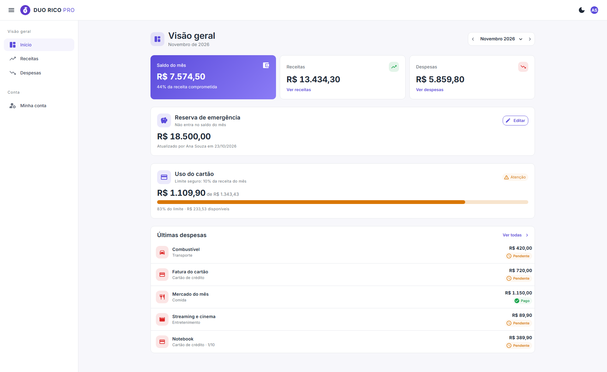
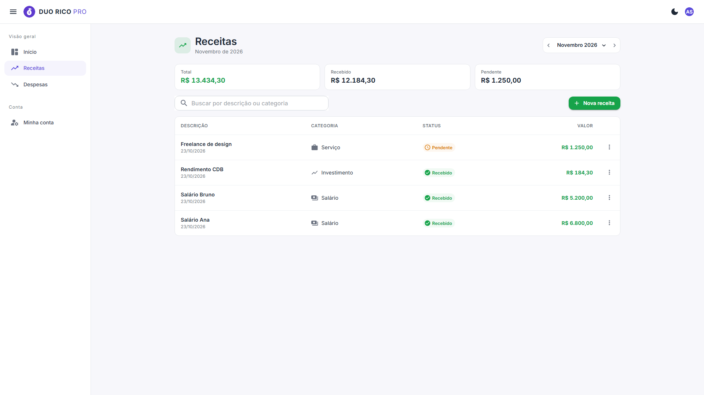
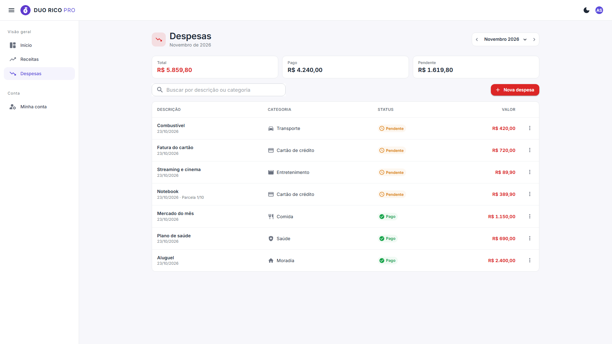
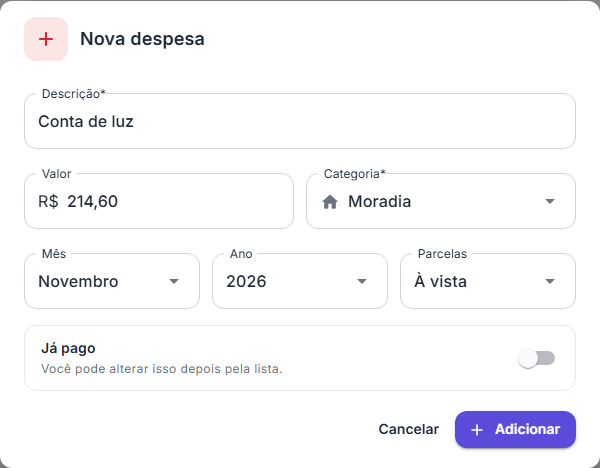
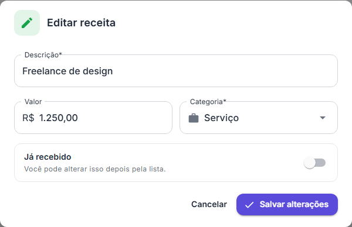
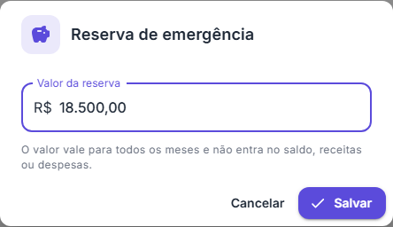
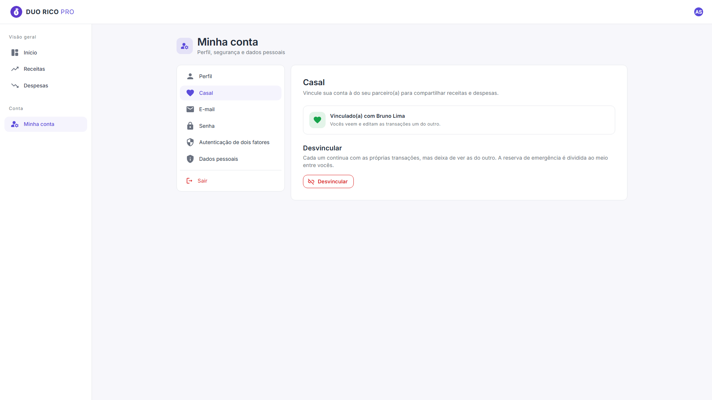
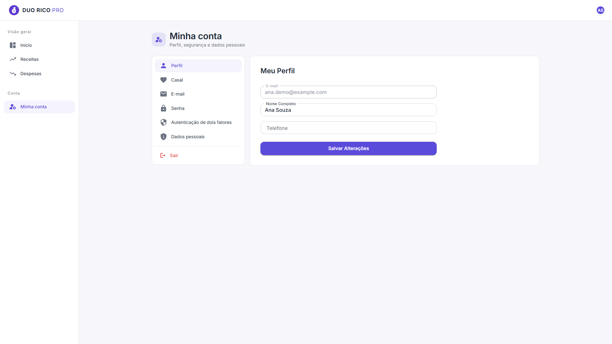

<div align="center">

# 💰 Duo Rico Pro

### Gestão Financeira Inteligente para Casais e Famílias

Aplicação moderna desenvolvida com **Blazor (.NET 10)** para controle de receitas, despesas, parcelamentos e pagamentos, com foco em **segurança**, **performance** e **experiência do usuário**.

<br>


</div>

---

## 📖 Sobre o Projeto

O **Duo Rico Pro** é uma plataforma de gestão financeira desenvolvida para auxiliar casais e famílias no controle financeiro compartilhado.

O projeto foi completamente reconstruído utilizando **Blazor (.NET 10)**, substituindo uma arquitetura anterior baseada em Razor Pages, proporcionando:

- ⚡ Maior performance
- 🎨 Interface moderna baseada em Material Design
- 🔒 Segurança de nível corporativo
- 📱 Experiência otimizada para dispositivos móveis
- ☁️ Infraestrutura preparada para produção

---

# ✨ Funcionalidades

## 👤 Autenticação e Segurança

- Login e Cadastro
- Recuperação de Senha
- Confirmação de E-mail
- Autenticação em Dois Fatores (2FA)
- Aplicativos Autenticadores (Google Authenticator e Microsoft Authenticator)
- Códigos de Recuperação
- ASP.NET Core Identity

---

## 💰 Gestão Financeira

- Cadastro de Receitas e Despesas
- Controle de Parcelamentos
- Status de Pagamento
- Dashboard Financeiro
- Relatórios Resumidos
- Organização por Casal (Couple ID)

---

## 📱 Experiência do Usuário

- Interface Responsiva
- Material Design com MudBlazor
- Layout de Autenticação Personalizado
- Navegação sem Dead Ends

---

# 🏗️ Arquitetura

```text
┌─────────────────────┐
│      Frontend       │
│       Blazor        │
└──────────┬──────────┘
           │
           ▼
┌─────────────────────┐        ┌──────────────────────┐
│ ASP.NET Core (.NET) │───────►│  Brevo API (HTTPS)   │
│     Identity        │        │ e-mail transacional  │
│   Entity Framework  │        └──────────────────────┘
└──────────┬──────────┘
           │
           ▼
┌─────────────────────┐
│ PostgreSQL (Neon)   │
└─────────────────────┘
```

Camadas, isolamento por casal, autenticação e acesso a dados estão detalhados em [docs/architecture.md](docs/architecture.md).

---

# 🛠️ Stack Tecnológica

| Tecnologia | Utilização |
|------------|------------|
| .NET 10 | Framework Principal |
| Blazor | Interface Web |
| MudBlazor | Componentes UI |
| Entity Framework Core | ORM |
| PostgreSQL | Banco de Dados |
| Neon | Banco Serverless |
| ASP.NET Identity | Autenticação |
| Brevo | E-mail Transacional (API HTTP) |
| Docker | Containerização |
| Render | Hospedagem |

---

# 📚 Documentação

| Documento | Conteúdo |
|-----------|----------|
| [docs/architecture.md](docs/architecture.md) | Camadas, isolamento por casal, autenticação, acesso a dados |
| [docs/adr/](docs/adr/README.md) | Registros de decisão de arquitetura (o porquê de cada escolha) |
| [docs/runbook.md](docs/runbook.md) | Deploy, rollback, migrations, rotação de segredos, incidentes |
| [SECURITY.md](SECURITY.md) | Como reportar vulnerabilidades, controles, gestão de segredos, LGPD |
| [CHANGELOG.md](CHANGELOG.md) | Mudanças de cada versão |
| [.editorconfig](.editorconfig) | Padrão de código aplicado pela IDE e pelo `dotnet format` |

---

# 🔐 Segurança

A aplicação segue boas práticas para ambientes de produção:

- Autenticação em Dois Fatores (2FA)
- Proteção contra vazamento de credenciais
- Uso de User Secrets em ambiente local
- API key do provedor de e-mail fornecida por variável de ambiente, fora do controle de versão
- Nenhuma credencial SMTP ou senha de aplicativo do Gmail armazenada na aplicação
- Senhas criptografadas pelo ASP.NET Identity
- Tokens seguros para redefinição de senha
- Confirmação de e-mail
- Controle de sessões autenticadas

Para reportar uma vulnerabilidade e conhecer a política de segredos, veja o [SECURITY.md](SECURITY.md).

---

# 📧 Envio de E-mails

Os e-mails transacionais do Identity (confirmação de cadastro, redefinição de senha e troca de e-mail) são entregues pela **API HTTP do Brevo**.

## Por que API HTTP e não SMTP

O Render **bloqueia o tráfego de saída nas portas SMTP 25, 465 e 587** em web services do plano free desde 26/09/2025 ([changelog oficial](https://render.com/changelog/free-web-services-will-no-longer-allow-outbound-traffic-to-smtp-ports)). A porta 25 permanece bloqueada em qualquer plano.

O sintoma é enganoso: a conexão não é recusada, ela pende até estourar o timeout e a requisição falha depois de cerca de 100 segundos — funcionando perfeitamente em ambiente local e falhando apenas em produção.

A API do Brevo usa **HTTPS na porta 443**, que não sofre bloqueio.

## Provedor

Brevo no plano gratuito:

- 300 e-mails por dia
- Remetente único verificado por código de 6 dígitos
- **Não exige domínio próprio** — importante, porque a aplicação roda em um subdomínio do Render

## Configuração no painel do Brevo

1. Criar a conta em [brevo.com](https://www.brevo.com) (plano Free, sem cartão)
2. **Settings → Senders, Domains & Dedicated IPs → Senders → Add a sender**: cadastrar o remetente e confirmar o código de 6 dígitos enviado para ele
3. **SMTP & API → API Keys → Generate a new API key**: gerar a chave, que tem o prefixo `xkeysib-`

> Sem um remetente verificado a API responde **400**. As chaves v3 do Brevo valem para toda a conta (não têm escopo por permissão) — trate como credencial de alto valor e planeje a rotação.

## Chaves de configuração

Seção `EmailSettings`, definida em `DuoRico.Pro/Services/EmailSettings.cs`:

| Chave | Obrigatória | Observação |
|-------|-------------|------------|
| `Provider` | Sim | `Brevo` (envia de verdade) ou `Log` (apenas escreve no console) |
| `SenderName` | Sim | Já vem com o valor padrão `Duo Rico Pro` no `appsettings.json` |
| `SenderEmail` | Somente se `Provider=Brevo` | Remetente verificado no painel do Brevo |
| `BrevoApiKey` | Somente se `Provider=Brevo` | Prefixo `xkeysib-`. **Secret** |

## Modo de desenvolvimento

Com `Provider=Log`, a implementação `LoggingEmailSender` escreve o link de recuperação direto no console e **nenhum segredo é necessário**. É o modo recomendado para desenvolver o fluxo de autenticação sem consumir a cota diária.

Com `Provider=Brevo`, o `BrevoEmailSender` envia de verdade.

## Validação no startup

A configuração é validada no boot com `ValidateOnStart()`. Se `Provider=Brevo` e a chave ou o remetente estiverem ausentes ou inválidos, **a aplicação não sobe** e o log aponta exatamente qual variável falta.

Isso é intencional — é preferível falhar alto e de forma legível a servir erro 500 silencioso em runtime. A consequência prática é que, no Render, **as variáveis de ambiente precisam estar configuradas antes do deploy**.

Arquivos de referência:

```text
DuoRico.Pro/Services/
 ├─ EmailSettings.cs        (opções + validação)
 ├─ BrevoEmailSender.cs     (envio via API HTTP)
 └─ LoggingEmailSender.cs   (modo desenvolvimento)
```

---

# 🚀 Executando Localmente

## Pré-requisitos

- .NET 10 SDK
- PostgreSQL (opcional)
- JetBrains Rider ou Visual Studio ou VS Code

---

## 1️⃣ Clonar o Projeto

```bash
git clone https://github.com/maxmalato/DuoRico.Pro.git

cd DuoRico.Pro
```

---

## 2️⃣ Configurar User Secrets

Dentro da pasta do projeto:

```bash
dotnet user-secrets set "ConnectionStrings:DefaultConnection" "Sua-Connection-String"

# Desenvolvimento: escreve o link no console, sem precisar de credencial
dotnet user-secrets set "EmailSettings:Provider" "Log"
```

Somente se quiser testar o envio real de e-mail localmente:

```bash
dotnet user-secrets set "EmailSettings:Provider" "Brevo"

dotnet user-secrets set "EmailSettings:SenderEmail" "remetente-verificado@exemplo.com"

dotnet user-secrets set "EmailSettings:BrevoApiKey" "xkeysib-..."
```

> O `appsettings.json` guarda apenas valores **não sensíveis** (`Provider` e `SenderName`). A API key nunca deve ser versionada, nem colocada no `Dockerfile` via `ENV`/`ARG` — camadas de imagem são inspecionáveis com `docker history`.

Veja a seção [Envio de E-mails](#-envio-de-e-mails) para obter a chave e entender o toggle `Provider`.

### Connection string do Neon (recomendado para produção)

Use o endpoint **com pooler** do Neon (o host termina em `-pooler`), que suporta muito mais conexões simultâneas, e limite o pool do Npgsql. Exemplo com valores fictícios:

```text
Host=ep-exemplo-123456-pooler.sa-east-1.aws.neon.tech;Database=duorico;Username=usuario;Password=********;SSL Mode=Require;Maximum Pool Size=20;Timeout=15;Keepalive=30;No Reset On Close=true
```

| Parâmetro | Por quê |
|---|---|
| `-pooler` no host | O PgBouncer do Neon multiplexa conexões; sem ele o limite de conexões do plano é atingido rápido. |
| `Maximum Pool Size=20` | Limita as conexões abertas por instância do app. |
| `Timeout=15` | Tempo máximo para abrir conexão (o Neon pode estar "acordando"). |
| `Keepalive=30` | Evita que conexões ociosas sejam derrubadas silenciosamente. |
| `No Reset On Close=true` | Necessário com o pooler em modo transação (o `DISCARD ALL` do reset não é suportado). |

O app já repete automaticamente falhas transitórias do banco (`EnableRetryOnFailure` no `Program.cs`).

### Rider

```text
Projeto
 └─ Tools
     └─ .NET User Secrets
```

---

## 3️⃣ Aplicar Migrations

```bash
dotnet ef database update
```

---

## 4️⃣ Executar

```bash
dotnet run
```

Acesse:

```text
https://localhost:5001
```

---

# 🐳 Docker

## Build da Imagem

```bash
docker build -t duorico-pro .
```

## Executar Container

```bash
docker run -p 8080:8080 duorico-pro
```

---

## Dockerfile

O build é multi-stage (SDK para compilar, `aspnet` para rodar) e expõe a porta `8080`. O arquivo fica em [DuoRico.Pro/Dockerfile](DuoRico.Pro/Dockerfile). Execute os comandos acima de dentro da pasta `DuoRico.Pro/`, que é o contexto de build usado pelo Render.

---

# 🏷️ Versionamento

O projeto segue o [Versionamento Semântico](https://semver.org/lang/pt-BR/) (`MAJOR.MINOR.PATCH`) e as mudanças de cada versão ficam no [CHANGELOG.md](CHANGELOG.md).

| Parte | Quando incrementar |
|-------|--------------------|
| `MAJOR` | Mudança incompatível (ex.: migration destrutiva ou que exige ação manual) |
| `MINOR` | Nova funcionalidade compatível |
| `PATCH` | Correção de bug ou ajuste sem nova funcionalidade |

A fonte única da versão é a propriedade `<Version>` do `DuoRico.Pro.csproj`. Ela não depende do `.git`, então funciona no build Docker do Render, que usa apenas a pasta do projeto como contexto.

## Checklist de release

1. Atualizar `<Version>` no `DuoRico.Pro/DuoRico.Pro.csproj`
2. No `CHANGELOG.md`, mover os itens de **Não lançado** para a nova versão, com a data
3. Commitar as duas alterações juntas
4. Criar e enviar a tag:

```bash
git tag -a v1.0.0 -m "v1.0.0"

git push --follow-tags
```

A versão em execução aparece no **menu do usuário** (avatar), visível apenas para usuários autenticados — de propósito, para não expor publicamente qual versão está no ar.

---

# ☁️ Deploy

O projeto foi preparado para deploy em plataformas modernas de hospedagem:

- Render
- Azure App Service
- Railway
- Fly.io
- VPS Linux com Docker

## Variáveis de Ambiente

Em produção a configuração vem do painel do provedor. O separador é o **duplo underscore** (`__`), equivalente ao `:` usado localmente:

| Variável | Valor | Secret |
|----------|-------|--------|
| `ConnectionStrings__DefaultConnection` | String de conexão do PostgreSQL | **Sim** |
| `EmailSettings__Provider` | `Brevo` | Não |
| `EmailSettings__SenderName` | `Duo Rico Pro` | Não |
| `EmailSettings__SenderEmail` | Remetente verificado no Brevo | Não |
| `EmailSettings__BrevoApiKey` | `xkeysib-...` | **Sim** |
| `DataProtection__CertificateBase64` | Certificado PFX (base64) usado para criptografar o keyring do Data Protection | **Sim** |
| `DataProtection__CertificatePassword` | Senha do PFX acima | **Sim** |

> ⚠️ **Configure as variáveis antes de disparar o deploy.** A validação de startup impede a aplicação de subir se algo estiver ausente ou inválido, o que leva o serviço a um ciclo de reinício. Se isso acontecer, corrija a variável ou reverta o deploy pelo painel do provedor.

### Data Protection

O keyring do Data Protection (usado por login por cookie, reset de senha e 2FA) é persistido no PostgreSQL via `PersistKeysToDbContext` e criptografado com um certificado, em vez de ficar no disco efêmero do container — caso contrário, todo redeploy/restart invalida sessões ativas e links de reset de senha pendentes.

Isso só é aplicado fora de `Development` — localmente (`dotnet run`, `dotnet ef`) o keyring padrão em disco continua funcionando sem nenhum certificado configurado, mesmo raciocínio do `Provider=Log` do `EmailSettings`.

A geração do certificado, a conversão para base64 e os cuidados na rotação estão no [runbook](docs/runbook.md#certificado-do-data-protection). Guardar o PFX original em um cofre de segredos — nunca no repositório.

Para procedimentos de deploy, rollback, migrations em produção e recuperação de incidentes, veja o [runbook de operação](docs/runbook.md).

---

# 📸 Screenshots

<p align="center">
  
  
</p>

<p align="center">
  
  
</p>

<p align="center">
  
  
</p>

<p align="center">
  
  
</p>

<p align="center">
  
</p>

---

# 🗺️ Roadmap

- [x] Sistema de Autenticação
- [x] Recuperação de Senha
- [x] 2FA
- [x] Dashboard Financeiro
- [x] Receitas e Despesas
- [ ] Relatórios Avançados
- [ ] Exportação PDF
- [ ] Exportação Excel
- [ ] Aplicativo Mobile

---

# 👨‍💻 Autor

**Maxjannyfer Malato**

Desenvolvedor Full Stack focado em .NET e React.

GitHub:
https://github.com/maxmalato

Portfólio:
https://maxmalato.netlify.app

---

# 📄 Licença

Projeto privado destinado ao gerenciamento financeiro familiar.
